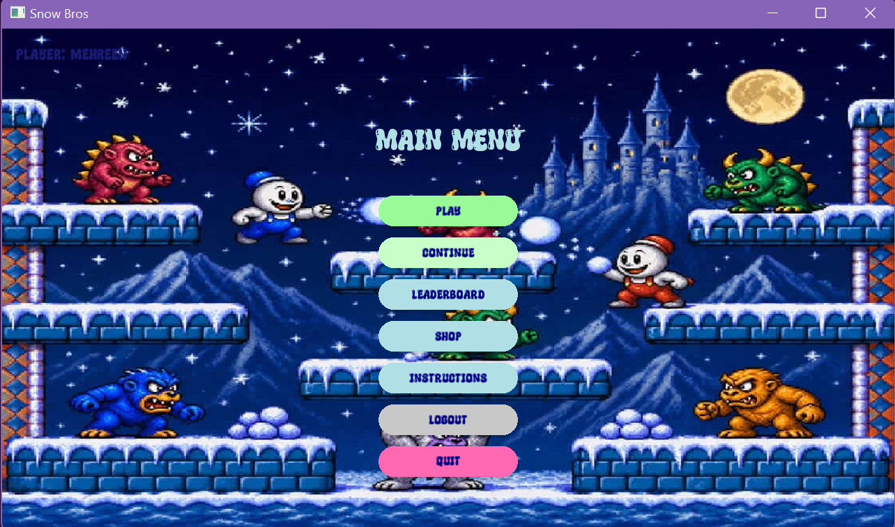
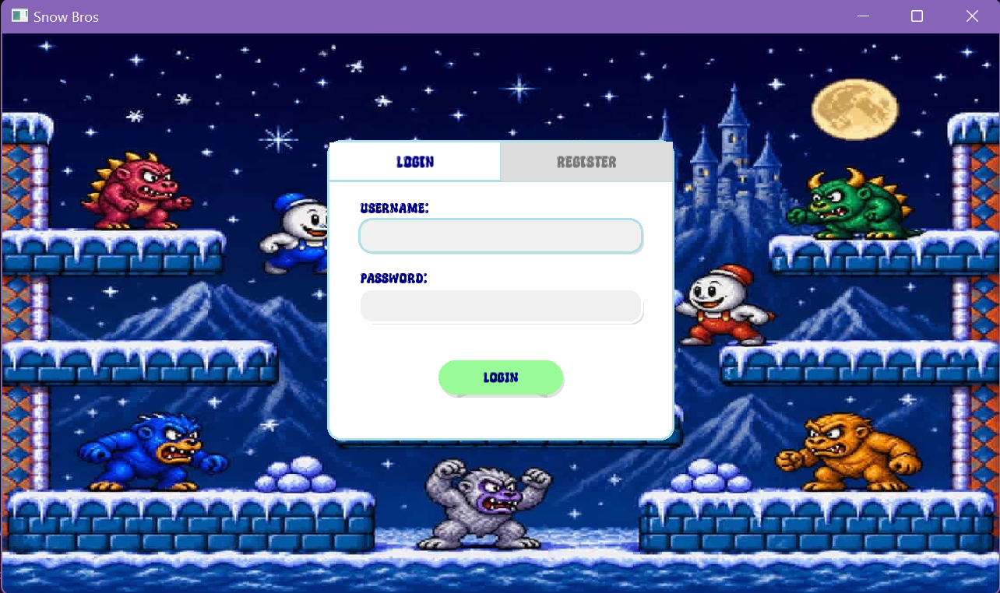
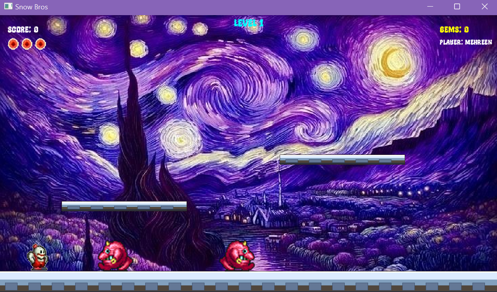
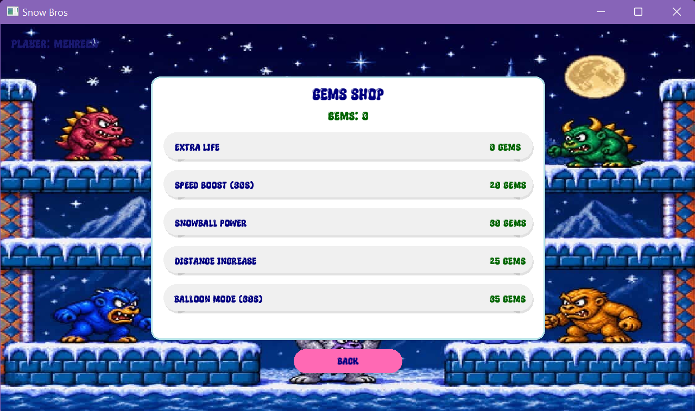
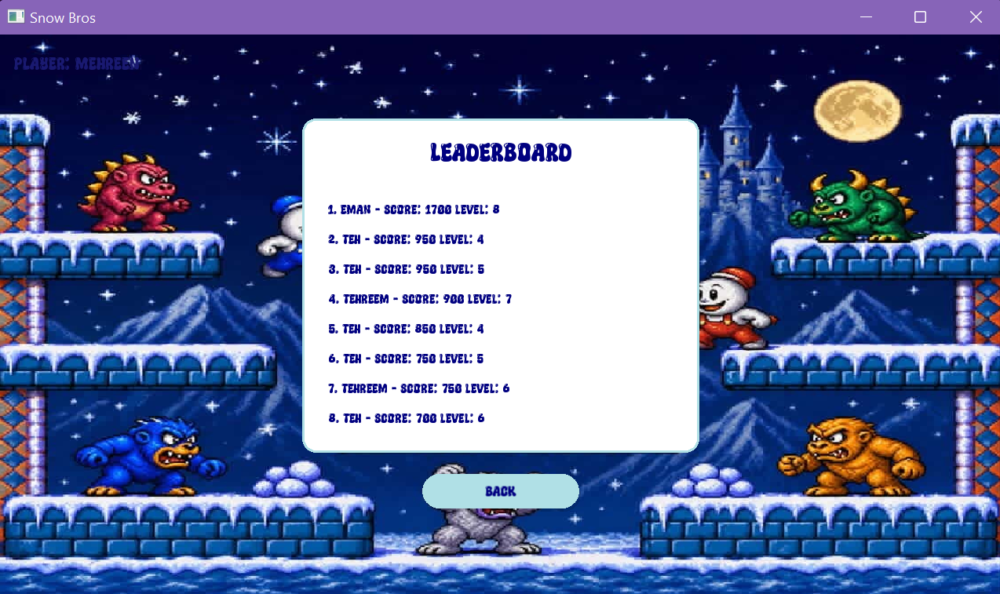

# ❄️ Snow Bros

A modern C++ recreation of the classic arcade game **Snow Bros**, built with **SFML 3**. Freeze enemies in snow, take down bosses, spend your gems in the shop, and climb the leaderboard. The game includes player accounts, level progression, power-ups, and saved progress between sessions.

<p align="center">
  
</p>

---

## ✨ Features

- **Player accounts**: register and log in with input validation and hashed passwords
- **Save and continue**: gems, levels, and high scores persist between sessions, so you can pick up where you left off
- **Level-based gameplay**: levels load from plain text files, so new levels need no code changes
- **Enemy variety**: walking, flying, and tornado enemies, plus boss fights (Mogera, Gamakichi) with unique attack phases and health bars
- **Gem shop and power-ups**: spend collected gems on extra lives, speed boosts, stronger snowballs, longer throw distance, and balloon mode
- **In-game HUD**: live score, lives, gem count, current level, and player name
- **Leaderboard**: see how your score and level stack up against other players
- **Polished UI**: login/register, main menu, instructions, shop, and leaderboard screens, all in a consistent arcade style

---

## 🛠️ Tech Stack

| | |
|---|---|
| **Language** | C++17 |
| **Graphics / Audio / Input** | SFML 3 |
| **Persistence** | File I/O (`.txt` files) |
| **IDE** | Visual Studio (Windows) |

---

## 🏗️ Architecture & OOP Design

The project is built around core Object-Oriented Programming principles.

**Abstract base classes and polymorphism**
- `Entity`: abstract base for all game objects (Player, Enemy), defining the `update()` and `draw()` contract
- `Screen`: abstract base for all UI states

**Inheritance hierarchies**
```
Enemy
├── Bottom (walking)
│   └── Flyng (flying)
│       └── Tornado (special)
└── Mogera / Gamakichi (bosses)

Screen
└── MainMenu, GameScreen, ShopScreen, LeaderboardScreen, ...
```

**Design patterns**
- **State pattern**: `ScreenManager` handles transitions (Main Menu → Character Select → Game), keeping UI logic separate from gameplay
- **Factory pattern**: `EnemyFactory` creates enemies from string types (e.g. `"FLYNG"`, `"TORNADO"`) read from level files, so adding an enemy type only means updating the factory

**Operator overloading**
- `Levels` overloads `operator>>` to parse level data straight from text files

---

## 🎮 Gameplay Systems

- **Level Manager**: loads platforms and enemy spawn points from `levelX.txt` files
- **Collision detection**: custom AABB (Axis-Aligned Bounding Box) checks between players, enemies, and platforms, using hitboxes defined in the base `Entity` class
- **Power-up system**: timer-based effects for potions and items
- **Save system**: `users.txt` and `progress.txt` store hashed credentials and player stats (gems, levels, high scores)

---

## 📁 Project Structure

```
├── main.cpp            # Entry point and ScreenManager runner
├── player.cpp / .h     # Player movement, animation, and state logic
├── enemy.cpp / .h      # Enemy AI and variant definitions
├── levelManager.cpp/.h # Level parsing and platform rendering
├── screen.h / .cpp     # Menu, HUD, and auth screens
├── levels/             # levelX.txt layout files
├── users.txt           # Registered users
└── progress.txt        # Saved player progress
```

> Adjust folder names to match your repository layout.

---

## 🚀 Getting Started

### Prerequisites
- Visual Studio with the **Desktop development with C++** workload
- [SFML 3](https://www.sfml-dev.org/download.php)

### Build and Run
1. Clone or download the repository.
2. Open the solution in Visual Studio.
3. Configure SFML include and library paths (**Project → Properties → C/C++ / Linker**).
4. Copy the SFML `.dll` files next to the executable.
5. Build and run in **Debug** or **Release** mode (x64 or x86, matching your SFML build).

---

## 🕹️ Controls

| Action | Key |
|---|---|
| Move left / right | `←` / `→` |
| Jump | `↑` |
| Shoot snow | `Space` |

> Replace with your actual key bindings.

---

## 📸 Screenshots

| Login / Register | Main Menu |
|:---:|:---:|
|  |  |

| Gameplay | Gems Shop |
|:---:|:---:|
|  |  |

| Leaderboard |
|:---:|
|  |

---

## 👩‍💻 Authors

- **Mehreen Mahmud** ([@mehreenn-14](https://github.com/mehreenn-14))
- **Tehreem Rasool** ([@partner-github-username](https://github.com/partner-github-username))

Built as a CS1004 Object-Oriented Programming project at FAST NUCES, Islamabad.

---

## 🙏 Acknowledgements

- Original *Snow Bros* by Toaplan, which inspired this project
- [SFML](https://www.sfml-dev.org/) for the multimedia library
- Credit any third-party sprites, sounds, or fonts you used here
